  

  
  
  

## 👋 About

- 🌏 Lived in 🇦🇺 🇳🇿 🇵🇭 for a year and a half before switching to tech
- 💼 Web developer by day, still learning by night — lately, a lot of AI
- ⚽ Spent my childhood on the soccer field
- ⌨️ Happily typing away, every day

## 🚢 Shipped

<table>
  <tr>
    <td width="50%" valign="top">
      <h3><a href="https://github.com/enknot96/kokosoko">Koko Soko</a></h3>
      
Select any area of a page — even beyond the screen — and get one seamless screenshot. It scrolls and stitches for you.

      
       TypeScript · Manifest V3 · Vite
    </td>
    <td width="50%" valign="top">
      <h3><a href="https://github.com/enknot96/shotext">ShoText!</a></h3>
      
Drag over anything on screen — images, videos, PDFs — and the text is OCR'd locally and copied. Nothing leaves your machine.

      <!-- TODO: replace with the Chrome Web Store URL -->
      
       TypeScript · Local OCR
    </td>
  </tr>
</table>

## ✍️ Writing

<!-- BLOG-POST-LIST:START -->
<!-- BLOG-POST-LIST:END -->

## 🧰 Stack

<table>
  <tr>
    <td><b>Web</b></td>
    <td>
      
      
      
      
      
    </td>
  </tr>
  <tr>
    <td><b>AI</b></td>
    <td>
      
      
      
    </td>
  </tr>
  <tr>
    <td><b>Data & Infra</b></td>
    <td>
      
      
      
      
    </td>
  </tr>
</table>

---

<code>shuto@enknot ~ % logout</code> &nbsp;— thanks for stopping by.

